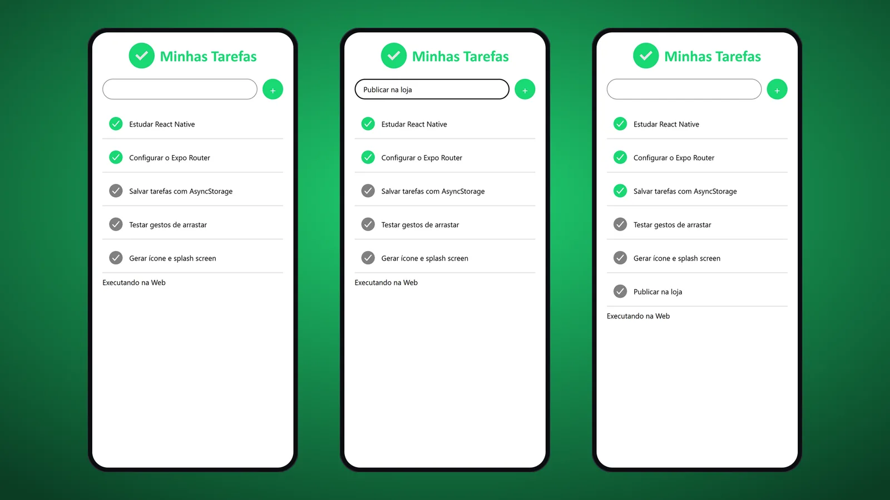
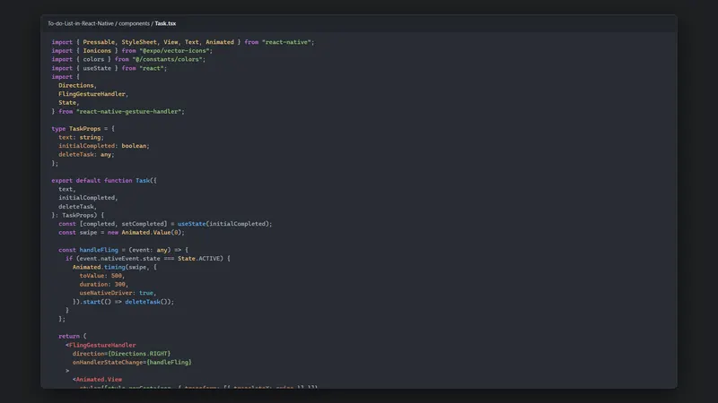

# To-do List em React Native com Expo

App mobile de tarefas com gestos, animação e dados salvos no aparelho.

<p align="center">
  
</p>

---

## Sumário

- [Visão geral](#visão-geral)
- [Telas](#telas)
- [Stack e versões](#stack-e-versões)
- [Estrutura do projeto](#estrutura-do-projeto)
- [Primeiros passos](#primeiros-passos)
- [Scripts](#scripts)
- [Autor](#autor)

---

## Visão geral

Aplicativo de tarefas feito com React Native e Expo para praticar os fundamentos do desenvolvimento mobile: componentes nativos e FlatList, input controlado, gesto de arrastar para apagar com animação, safe areas, ícone e splash screen, comportamento diferente por plataforma (Android, iOS e Web) e persistência com AsyncStorage.

Principais funcionalidades:

- Gesto de arrastar com animação
- Dados salvos com AsyncStorage
- Roda em Android, iOS e Web

Concluído em 05/2025.

---

## Telas

Todas as telas usam dados fictícios.

<table>
  <tr>
    <td width="50%"><br><sub>Componente com gesto de arrastar e animação</sub></td>
  </tr>
</table>

---

## Stack e versões

| Categoria | Tecnologia | Versão |
| --- | --- | --- |
| Linguagem | TypeScript | 5.8 |
| UI | React | 19.0 |
| Mobile | Expo + React Native | 53.0 / 0.79 |
| Rotas | Expo Router | 5.0 |
| Animação | Reanimated | 3.17 |
| Gestos | Gesture Handler | 2.24 |
| Persistência | AsyncStorage | 2.1 |
| Qualidade | ESLint + Prettier | 9.25 / 3.5 |

As versões exatas estão no `package.json`.

---

## Estrutura do projeto

```
app/
  _layout.tsx
```

---

## Primeiros passos

### Pré-requisitos

- Node.js 18 ou mais recente
- npm
- App **Expo Go** no celular, ou um emulador Android/iOS

### Instalação

```bash
git clone https://github.com/marcospsdev/To-do-List-in-React-Native.git
cd To-do-List-in-React-Native
npm install
npx expo start
```

Leia o QR code com o Expo Go (Android) ou a câmera (iOS). Para a versão web, aperte `w` no terminal.

---

## Scripts

| Comando | Descrição |
| --- | --- |
| `npm start` | Inicia o Expo (QR code para o Expo Go) |
| `npm run android` | Abre no emulador ou aparelho Android |
| `npm run ios` | Abre no simulador iOS |
| `npm run web` | Abre a versão web no navegador |
| `npm run lint` | Analisa o código com o ESLint |

---

## Autor

**Marcos Paulo** · Desenvolvedor Full-Stack

- LinkedIn: [in/marcospsdev](https://www.linkedin.com/in/marcospsdev)
- GitHub: [@marcospsdev](https://github.com/marcospsdev)
